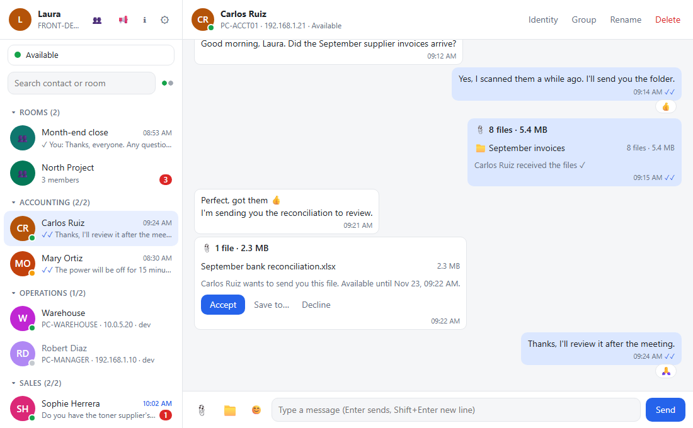
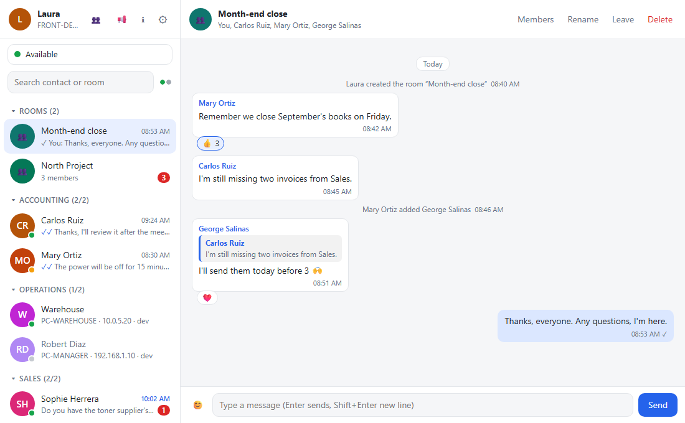
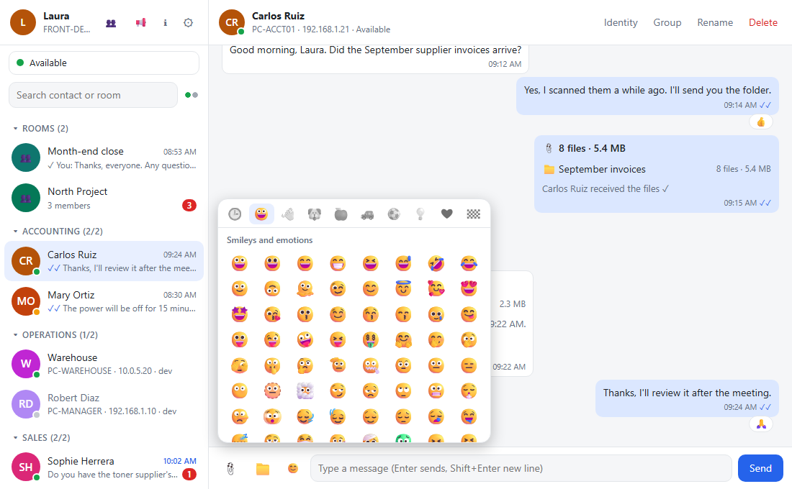
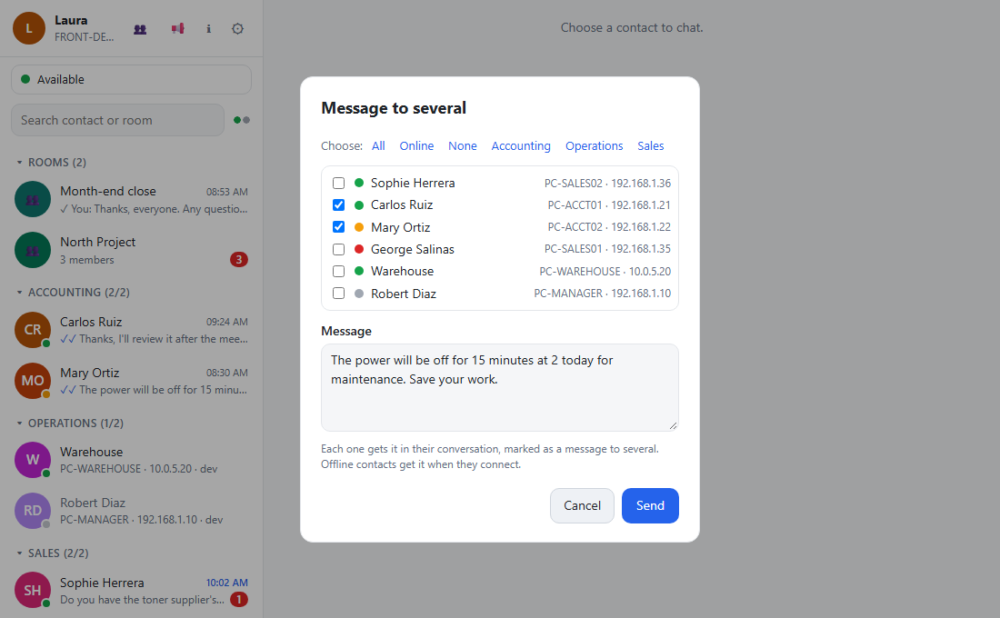
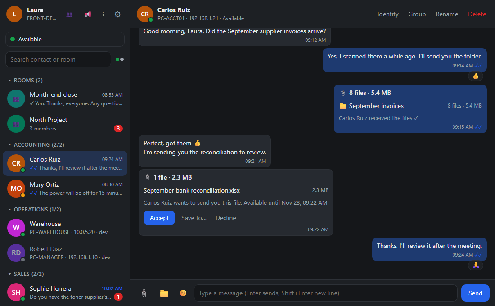

<p align="center">
  
</p>

<h1 align="center">LanChat</h1>

<p align="center">
  Messaging and file sharing for the office's local network.<br>
  No server, no accounts, no Internet: install it on each PC and Android phone, and you're done.
</p>

<p align="center">
  <a href="https://github.com/AEROGU/lanchat/releases/latest"></a>
  <a href="https://github.com/AEROGU/lanchat/actions/workflows/ci.yml"></a>
  <a href="LICENSE"></a>
  
  
</p>

<p align="center">
  <b>English</b> · <a href="README.es.md">Español</a>
</p>

<p align="center">
  
</p>

## Features

- **No server, no setup**: PCs on the network find each other on their own.
  For another subnet, adding a single PC (by IP or computer name) is enough:
  the rest of that subnet comes through it ([details](#devices-on-other-subnets)).
- **No accounts**: everyone picks their own name and, optionally, a
  **profile photo** (without one, their initials show on a color). The
  computer name and IP show in the conversation and when hovering over the
  contact. You can give each contact an alias and a group.
- **WhatsApp-style list**: the conversation with the most recent activity
  on top, with the start of the last message, its time, ✓/✓✓ if it's yours
  and the unread count.
- **One-to-one messages** with history, delivery to offline contacts when
  they connect, ✓ delivered and ✓✓ read (can be turned off).
- **Emoji reactions** on any message, and **delete for everyone** your own
  message within 15 minutes of sending it. A file transfer too, once it was
  downloaded, canceled, declined or expired: whatever was downloaded stays in
  the other person's folder. A transfer that went nowhere can be **deleted
  from this device** at any time.
- **Edit** your own message within the same 15 minutes (it shows "edited"),
  and **forward** messages to other contacts or rooms (they show
  "Forwarded"). Messages can be **copied**, and you can **select several**
  to copy them (Ctrl+C, with time and author like WhatsApp Web), forward them
  or delete them for everyone. On the PC, right-clicking a message opens its
  menu. A file can be forwarded while it's still in the downloads folder (or,
  if you sent it, where it was); only text is forwarded to rooms.
- **Reply** to an earlier message or file transfer, like in WhatsApp: the
  reply carries a quote of the original on top and tapping it jumps there. If
  the author edits the original, the quote updates; if they delete it for
  everyone, the quote shows "Deleted message".
- **Emoji picker** 😊 next to the text box, with all of Unicode's emoji by
  category and the recently used ones, on the PC and on the phone.
- **Group chat rooms** with admins (whoever creates a room can remove
  members and make others admins) and **messages to several** contacts or to
  a group.
- **Files and folders** (button, or drag and drop onto the conversation or a
  contact in the list): the other person has to accept them (into their
  downloads folder or, on the PC, with **Save to…** into the folder they
  choose); they're downloaded only once, resume if the network drops and are
  verified with SHA-256. Images (JPG, PNG, GIF, WebP) arrive with a
  **preview** before being accepted and open full size with a click.
- **Status**: Available, Away and Busy, with a message and automatic away.
- **Encryption**: TLS 1.3 between PCs, with a warning if a device's identity
  changes.
- **Privacy**: download a copy of your data or delete it (all of it, or one
  conversation), for example when someone leaves the company.
- **English and Spanish**: it uses the Windows or phone language (any other
  untranslated language falls back to English) and can be changed in
  **Settings > Language**. In a room with people using different languages,
  everyone sees the notices ("Ann added Luis") in their own. [More languages
  can be added](#translations).
- System tray icon, Windows notifications, start with Windows, light and dark
  theme. A single `.exe`, nothing else to install.

| Chat rooms | Emoji | Message to several | Dark theme |
|---|---|---|---|
| [](docs/screenshots/en/room.png) | [](docs/screenshots/en/emoji.png) | [](docs/screenshots/en/broadcast.png) | [](docs/screenshots/en/dark-theme.png) |

## Download

1. Download `LanChat-<version>.zip` from the [latest release](https://github.com/AEROGU/lanchat/releases/latest).
2. Unzip it into a permanent folder (e.g. `C:\LanChat` or Documents) and run
   `LanChat.exe` (`LanChat_x86.exe` if the PC has 32-bit Windows; wherever
   this page says `LanChat.exe`, on those PCs it's that one).
3. When Windows asks, allow access on **private networks**.
4. Repeat on every PC in the office.

Requirements: Windows 10 or 11 (64 or 32 bits) with Microsoft Edge (it comes
with Windows). The network must be marked as **private** in Windows and allow
UDP 50000 and TCP 50001 between the PCs. If you can see someone but your
messages don't reach them, see [this section](#you-can-see-someone-but-messages-dont-reach-them).

### On Android

1. Download `LanChat-<version>.apk` from the [latest release](https://github.com/AEROGU/lanchat/releases/latest)
   on the phone and open it. Android will ask to allow "install unknown apps"
   for the app you opened it with (browser, Files…).
2. When LanChat opens, allow **notifications** and, on the battery notice,
   choose **Continue** and then **Allow**.
3. On **OPPO, Xiaomi, Huawei, Vivo** and similar phones: in LanChat, Settings
   > "the app info" > Battery usage, turn on **Allow background activity**.
   Otherwise the phone freezes LanChat with the screen off and messages
   arrive late.

Requirements: Android 7 or later, connected to the office Wi-Fi. It's the same
interface as on the PC; LanChat starts by itself when the phone turns on (it
can be turned off in Settings) and is stopped from its notification. For
phones to see the PCs with the screen off, the PCs must have the same version
or a later one.

From other apps (Gallery, Files, WhatsApp…), **Share > LanChat** sends
photos, files or text: LanChat opens and asks which contacts to send them to.

### Windows SmartScreen warning

LanChat isn't signed with a code signing certificate (they cost money every
year). So the first time a `LanChat.exe` downloaded from the Internet is
opened, Windows may show **"Windows protected your PC"**. To open it:

1. Click **More info**.
2. Click **Run anyway**.

It's only needed the first time on each PC. Download LanChat only from the
project's official page (https://github.com/AEROGU/lanchat). To check that
the zip wasn't altered, compare its SHA-256 (`Get-FileHash
LanChat-<version>.zip` in PowerShell) with the one in `SHA256SUMS.txt` of the
same release, or build the source code yourself (see [Building](#building)).

## Usage

`LanChat.exe` opens the window and stays in the system tray (left click:
open; right click: menu with **Quit**). Closing the window doesn't close
LanChat. Opening it again while LanChat is already open just shows the window.

The first time, Windows will ask for network permission: allow it on
**private networks** (UDP 50000 and TCP 50001). The rule can also be created
from Settings > Windows Firewall, or with `LanChat.exe -firewall add`.

### Updates

LanChat looks for new versions in
[Releases](https://github.com/AEROGU/lanchat/releases) when it opens, once a
day, and when another device with a newer version shows up on the network. If
there is one, it **asks** before installing ("Not now" leaves it until the
next time it opens). When you accept:

- **On Windows** it downloads the zip, checks its SHA-256 against the
  `SHA256SUMS.txt` of the same release, puts the matching executable
  (`LanChat.exe` or `LanChat_x86.exe`) in place of the current one, deletes
  the zip and restarts LanChat. Starting with Windows and the firewall rule
  keep working, because the path doesn't change. If LanChat is in a protected
  folder (e.g. `C:\Program Files`) it can't be replaced: it says so and you
  have to update manually.
- **On Android** it downloads the APK (also checked against
  `SHA256SUMS.txt`) and opens the Android installer, which asks for
  confirmation. The first time, Android asks to allow "Install unknown apps"
  for LanChat.

**Settings > Updates** has the **Check for updates** button and the **Check
for updates automatically** checkbox (with it off, LanChat only contacts
GitHub when you press the button). The version another device announces is
only a hint: what gets installed always comes from GitHub. Your own builds
with uncommitted changes (`-dirty`) don't update themselves.

### Devices on other subnets

It's enough to add **a single PC** from the other subnet, on **a single PC**
of yours: Settings > "Devices on other subnets", with its IP or computer name.
Devices share the list of the ones they know every 2 minutes, so all the PCs
of that subnet arrive and your coworkers see them too. It's best to pick a PC
that's almost always on and has a fixed IP (or add two). The computer name
follows the PC even if its IP changes, but only if the network resolves names
across subnets (`ping NAME` checks it). Routers must let traffic through
between the two subnets; otherwise LanChat can't get there.

### You can see someone but messages don't reach them

Showing up in the list only proves discovery (UDP 50000, which goes out from
each PC). Messages and files come **in** through TCP 50001, and that's
blocked by the receiving device's firewall. It happens mostly if its network
is set as "Public" or if the PC has several networks (e.g. Ethernet and
Wi-Fi). The fix is an **inbound** rule for `LanChat.exe` on **all networks**
(private, public and domain); no outbound rule is needed. In a command prompt
as administrator, with that device's path:

```bat
netsh advfirewall firewall add rule name="LanChat" dir=in action=allow enable=yes profile=any program="C:\LanChat\LanChat.exe"
```

The rule is tied to the `.exe` path: if it moves to another folder, it has to
be created again. If there's a **block** rule for `LanChat.exe` (it's created
if the Windows prompt was ever canceled), delete it in *Windows Firewall >
Advanced settings > Inbound Rules*. To check from another PC:
`Test-NetConnection <IP> -Port 50001` in PowerShell must say
`TcpTestSucceeded : True`.

The first time, LanChat asks whether it should start with Windows (in the
tray); it can be turned off in Settings. With `-dir` it's left alone, so as
not to replace the one of the normal installation.

Options:

| Option | Use |
|---|---|
| `-tray` | start only in the tray (for starting with Windows) |
| `-dir folder` | another data folder (default `%APPDATA%\LanChat`) |
| `-version` | show the version |
| `-firewall add` / `remove` | create or remove the Windows Firewall rule (asks for administrator) |
| `-uninstall` | uninstall LanChat from this PC (asks before deleting; see [Uninstalling](#uninstalling)) |

For troubleshooting, `go tool mage debug` builds `dist/lanchat-debug.exe`,
which has a console:

| Option | Use |
|---|---|
| `-debug` | detailed log in the console instead of `lanchat.log` |
| `-console` | use LanChat from the console, without a window (`/ayuda` lists the commands, in Spanish) |

## Security

All communication between PCs (messages, files, notices) is encrypted with
**mutual TLS 1.3**. Each installation creates its own identity (an ECDSA
P-256 key in `identity.key`) and the others recognize it by its
**fingerprint**:

- The first time a PC sees another, it stores its fingerprint (trust on first
  use, like SSH). From then on it only talks to that identity.
- If the fingerprint changes (LanChat was reinstalled, or someone is trying
  to impersonate that PC), sending stops and the conversation shows a warning
  with **Trust the new identity**.
- Fingerprints show under the **Identity** button of each conversation; to
  verify, compare them with the other person.
- Discovery over UDP isn't encrypted (the announced name, hostname, status
  and fingerprint are visible on the network), but it doesn't allow
  impersonating anyone: the TLS connection checks the fingerprint.
- The profile photo travels encrypted, but any LanChat on the network can ask
  for it, just as everyone sees the announced name.
- Received files carry Windows' "mark of the Web", like files downloaded with
  a browser, and LanChat asks for confirmation before opening programs or
  scripts.

Since 0.18, protocol v3 is used, which doesn't talk to earlier versions: that
way every device honors "Delete for everyone" (file transfers included). In
the list, next to the IP, you can see each contact's LanChat version; one
with an earlier (or newer) version shows as **incompatible** in red, and you
can't write to it or receive its messages. LanChat sends it a one-time
automatic notice to update from https://github.com/AEROGU/lanchat/releases.
Whatever was queued for it is delivered when it updates. All PCs and phones
need to be updated.

## Privacy

In **Settings > Privacy**:

- **Download my data**: saves a copy of `lanchat.db` to Downloads (history,
  contacts, rooms, file offers and profile photos). It opens with any SQLite
  program, e.g. DB Browser for SQLite.
- **Delete all my data** (e.g. when someone leaves the company): leaves the
  rooms notifying the others, cancels pending files and deletes the
  conversations, rooms, contact aliases and groups, the name, the status
  message and the profile photo (and the stored ones of your contacts). It
  asks you to type `DELETE` (`BORRAR` with LanChat in Spanish) to confirm. It
  keeps the network settings and the PC's identity. Files already received
  stay in their folder.

Each conversation (or room) also has the **Delete** button: it deletes its
messages and cancels pending files with that contact; the contact is kept.
Deleting a room you already left removes it from the list.

An **offline** contact also has **Remove**: it takes it out of the list. It's
useful when someone reinstalled LanChat (or deleted their data) and shows up
again with another identity: LanChat asks whether to merge their conversation
with another contact's (it suggests the one with the same name or computer)
or delete it. If that device connects again, it reappears in the list. Each
merged message carries a small label with its origin ("⤷ Merged from Angelika
· OPPO Reno10 5G · 192.168.1.149", with the name that device announced, not
the alias), so nobody can pass it off as written by the other contact.

Messages and files never leave the local network. The only thing that
connects to the Internet is the update check, which contacts github.com (see
[Updates](#updates); it can be turned off in Settings).

Deleted data can't be recovered from `lanchat.db`: the database uses
`secure_delete` (it overwrites with zeros) and its log (`-wal`) is emptied.
Deleting only happens on this PC: the others keep their copy of the
conversations.

## Uninstalling

**On Windows**, any of these three ways opens the uninstaller:

- **Settings > Uninstall LanChat from this PC…**
- double-click **`Desinstalar LanChat.cmd`**, next to `LanChat.exe`
- `LanChat.exe -uninstall`

The uninstaller asks before deleting anything. Then it closes LanChat and
removes:

- starting with Windows and the notification registration;
- the Windows Firewall rules (it asks for administrator permission);
- the data folder `%APPDATA%\LanChat`: conversations, contacts, rooms,
  settings, the PC's identity and the log. The folder is only removed if it
  has no files unrelated to LanChat;
- if you answer yes to the second question, the **received files**.
  `Downloads\LanChat` is deleted entirely; if you chose another folder in
  Settings, only the files LanChat saved there are deleted, not yours.

At the end it opens the program folder for you to delete: it's the only thing
the uninstaller can't remove, because `LanChat.exe` is in use.

Uninstalling deletes your data without notifying the others. If you're in
rooms and want the other members to know you left, use **Settings > Privacy >
Delete all my data** first.

### Manually, leaving no trace

1. Close LanChat: right-click the tray icon > **Quit**.
2. Starting with Windows and notifications (in a command prompt):

   ```bat
   reg delete "HKCU\Software\Microsoft\Windows\CurrentVersion\Run" /v LanChat /f
   reg delete "HKCU\Software\Microsoft\Windows\CurrentVersion\Explorer\StartupApproved\Run" /v LanChat /f
   reg delete "HKCU\Software\Classes\AppUserModelId\LanChat" /f
   ```

   If one says it can't find the key, it didn't exist.
3. Firewall: `LanChat.exe -firewall remove` (asks for administrator), or in
   *Windows Firewall > Advanced settings > Inbound Rules* delete the LanChat
   and `LanChat.exe` rules.
4. Data: delete the `%APPDATA%\LanChat` folder (paste it as is into File
   Explorer's address bar). It holds the `lanchat.db` database, the identity,
   the settings and the log.
5. Received files: delete `Downloads\LanChat`, or the folder you chose in
   Settings.
6. Delete the folder where you unzipped LanChat.

LanChat doesn't store anything anywhere else. Windows and antivirus software
may keep their own records that the program ran (for example, in their
histories); that doesn't depend on LanChat.

**On Android**: uninstall the app like any other (long-press its icon >
Uninstall); that deletes its data. Received files stay in *Downloads >
LanChat*: delete them from the Files app if you don't want them.

## Files in `%APPDATA%\LanChat`

| File | Contents |
|---|---|
| `config.json` | device ID, name, language, ports, devices on other subnets |
| `identity.key`, `identity.crt` | this PC's identity; don't copy them to another PC (if they're deleted, the others will see "identity changed") |
| `lanchat.db` | contacts, aliases and history (SQLite) |
| `lanchat.log` | log (rotated past 1 MB); it doesn't store messages |
| `ui.json` | port and token of the window; it exists while LanChat is open |
| `icon.png` | icon used by notifications |
| `edge\` | Edge profile of LanChat's window |

## Building

Requires Go (the version in `go.mod`). Mage, staticcheck and govulncheck
install themselves as module tools (`tool` in `go.mod`); nothing else is
needed.

```bash
go tool mage              # lists the targets with their description
go tool mage build        # builds dist/LanChat.exe (no console)
go tool mage build32      # builds dist/LanChat_x86.exe, for 32-bit Windows
go tool mage debug        # builds dist/lanchat-debug.exe, with a console
go tool mage check        # gofmt, go vet, staticcheck, Android build and tests: before each commit
go tool mage race         # tests with the race detector (requires gcc)
go tool mage vuln         # known vulnerabilities in the code and its libraries
go tool mage dist         # dist/LanChat-<version>.zip (64- and 32-bit exe, LEEME, license, notices) and SHA256SUMS.txt
go tool mage screenshots  # regenerates docs/screenshots/<language> and docs/logo.png (requires Edge)
go tool mage emoji        # regenerates the picker's emoji list from Unicode (requires Internet)
go tool mage android      # android/app/libs/lanchat.aar for the Android app (see docs/ANDROID.md, in Spanish)
go tool mage apk          # dist/LanChat-<version>-debug.apk to try on the phone (debug signature)
go tool mage apkRelease   # dist/LanChat-<version>.apk signed with your own key (see docs/ANDROID.md)
```

`build` and `build32` first generate `cmd/lanchat/rsrc_windows_amd64.syso`
and `rsrc_windows_386.syso` (the .exe's icon, version and manifest, target
`resources`); they aren't versioned. Go 1.21 and later no longer work on
Windows 7 or 8, so the 32-bit .exe also requires Windows 10. The text of the
zip's `LEEME.txt` is in `packaging/LEEME.txt`.

The executable's version comes from `git describe`: the tag `v1.0.0` gives
version 1.0.0.

Screenshots are taken with the real interface and a demo office with
fictitious data (`internal/ui/demo_test.go`), in each language, so they can
be regenerated whenever the interface changes. The design and the protocol
are described in [PLAN.md](PLAN.md) (in Spanish).

### Translations

The texts of the interface, errors and tray are in one file per language,
`internal/i18n/locales/<code>.json` (`en.json`, `es.json`), with flat keys
and `{placeholders}`:

```json
{
  "_name": "English",
  "select.count": { "one": "{n} selected", "other": "{n} selected" }
}
```

To add a language (e.g. French):

1. Copy `en.json` to `fr.json`, set `"_name"` to the language's name in that
   language (`"Français"`) and translate the texts (not the keys or the
   `{placeholders}`).
2. Copy `android/app/src/main/res/values/strings.xml` to `values-fr/` and
   translate it, and add `<locale android:name="fr" />` to
   `android/app/src/main/res/xml/locales_config.xml`.
3. Optional: add `"fr"` to `screenshotLanguages` in
   `magefiles/screenshots.go` (and its data to the demo office) to get
   screenshots in that language.

The language shows up in Settings by itself. `go tool mage check` fails if a
language is missing a key or a `{placeholder}`, or if Android is missing its
translation.

### GitHub Actions

- `.github/workflows/ci.yml`: on every push to `main` or `develop` and on
  every pull request it runs `check`, `race`, `vuln` and `build` on Windows,
  and builds the test APK on Ubuntu.
- `.github/workflows/release.yml`: when a `vX.Y.Z` tag is pushed it checks
  everything, builds the zip, builds the signed APK (with the key from the
  *secrets*, see [docs/ANDROID.md](docs/ANDROID.md#clave-de-firma)) and
  creates the Release with both and `SHA256SUMS.txt`. The Release text is
  the tag message:

  ```bash
  git tag -a v1.0.0 -m "LanChat 1.0.0: what's new in this version"
  git push origin v1.0.0
  ```

  A tag with a hyphen (`v1.1.0-rc.1`) is published as a pre-release: it
  doesn't become the "latest release". Run manually
  (`gh workflow run release.yml`), it only builds and signs the APK, without
  publishing.

- `.github/dependabot.yml`: weekly pull requests with new versions of the Go
  libraries, the actions and the Android app.

## License

Copyright © 2026 Arturo Enrique Rosas Gutiérrez.

LanChat is free software: you can use, study, modify and redistribute it
under the terms of the **GNU General Public License, version 3** (GPL v3),
published by the Free Software Foundation. Anyone distributing LanChat or a
modified version must keep this notice and the credit to the original
author, and publish the source code under the same license.

It's distributed in the hope that it will be useful, but **without any
warranty**, not even the implied warranty of merchantability or fitness for
a particular purpose. See the full text in [LICENSE](LICENSE).

The picker's emoji list comes from Unicode's data (Unicode License v3). The
third-party libraries included in the executable (all under BSD, MIT or
Apache 2.0 licenses, compatible with the GPL v3) are listed with their
notices in `THIRD_PARTY_NOTICES.txt`, generated by `go tool mage notices`
and included in the zip.
